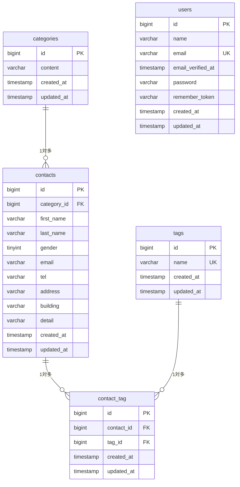

# COACHTECH お問い合わせフォーム

## 概要

このアプリは商品やサービスに関する問い合わせを受け付けるためのものです。

一般のお客様はログインせずにフォームから問い合わせを送信できて、送信前に確認画面で入力内容を見返すことができます。

管理者は管理画面で届いた問い合わせの一覧表示、検索、削除ができます。タグの管理もできます。

## 実装した機能

### 基本機能

- お問い合わせフォーム（入力 → 確認 → 送信 → 完了）
- 入力値のバリデーション（日本語のエラーメッセージ）
- 管理者の新規登録・ログイン・ログアウト
- 管理画面でのお問い合わせ一覧表示（7件ごとのページネーション）
- 名前・メールアドレス・性別・カテゴリ・日付による絞り込み検索
- お問い合わせの詳細表示・削除
- タグの追加・編集・削除

### 応用機能

- 検索条件に対応した CSV エクスポート
- 公開API（お問い合わせの一覧取得・詳細取得・作成・更新・削除）

## ER図



categories と contacts は一対多の関係です。
理由は、一つのカテゴリには複数の問い合わせが登録されますが、1件の問い合わせにはカテゴリは1件だけになるからです。

contacts と tags は多対多の関係です。
理由は、1件の問い合わせには複数のタグをつけられて、同じタグを複数の問い合わせにつけることもできるからです。

しかし、これでは多対多は2つのテーブルで表現することができないので、contact_tag という中間テーブルが必要になります。
同じタグが2重につくのを防ぐために、contact_id と tag_id の組み合わせにユニーク制約を設けています。

## 使用技術

| 項目 | 値 |
| --- | --- |
| PHP | 8.2 |
| Laravel | 10.x |
| DB | MySQL 8.0 |
| Web サーバー | Nginx |
| フロント | Vite / Tailwind CSS 3.4 / Alpine.js |
| 認証 | Laravel Fortify |
| 環境 | Docker / Laravel Sail / phpMyAdmin |

## 環境構築手順

### 1. リポジトリをクローンする

```bash
git clone git@github.com:Noriaki-Takaoka/contact-form-app.git
cd contact-form-app
```

### 2. 依存パッケージをインストールする

```bash
docker run --rm \
    -u "$(id -u):$(id -g)" \
    -v "$(pwd):/var/www/html" \
    -w /var/www/html \
    -e COMPOSER_CACHE_DIR=/tmp/composer_cache \
    laravelsail/php82-composer:latest \
    composer install
```

### 3. 環境設定ファイルを作成する

```bash
cp .env.example .env
```

`.env` のデータベース設定を以下にします。

```
DB_CONNECTION=mysql
DB_HOST=mysql
DB_PORT=3306
DB_DATABASE=laravel
DB_USERNAME=sail
DB_PASSWORD=password
```

### 4. コンテナを起動する

```bash
./vendor/bin/sail up -d
```

### 5. アプリケーションキーを生成する

```bash
./vendor/bin/sail artisan key:generate
```

### 6. マイグレーションと初期データ投入を実行する

```bash
./vendor/bin/sail artisan migrate --seed
```

### 7. フロントエンドをビルドする

```bash
./vendor/bin/sail npm install
./vendor/bin/sail npm run build
```

### 8. 動作確認

ブラウザで http://localhost にアクセスします。

## 開発環境URL

- アプリ: http://localhost
- phpMyAdmin: http://localhost:8080

## 管理者アカウント（初期データ）

- メールアドレス: admin@example.com
- パスワード: password123

## 画面一覧

| 画面 | メソッド | パス | 認証 |
| --- | --- | --- | --- |
| お問い合わせフォーム入力 | GET | / | 不要 |
| お問い合わせ確認 | POST | /contacts/confirm | 不要 |
| お問い合わせ送信 | POST | /contacts | 不要 |
| サンクスページ | GET | /thanks | 不要 |
| 管理者登録 | GET / POST | /register | 不要 |
| ログイン | GET / POST | /login | 不要 |
| ログアウト | POST | /logout | 必要 |
| 管理画面（一覧・検索） | GET | /admin | 必要 |
| お問い合わせ詳細 | GET | /admin/contacts/{contact} | 必要 |
| お問い合わせ削除 | DELETE | /admin/contacts/{contact} | 必要 |
| CSV エクスポート | GET | /contacts/export | 必要 |
| タグ追加 | POST | /admin/tags | 必要 |
| タグ編集 | GET | /admin/tags/{tag}/edit | 必要 |
| タグ更新 | PUT | /admin/tags/{tag} | 必要 |
| タグ削除 | DELETE | /admin/tags/{tag} | 必要 |

## APIエンドポイント一覧

認証は不要です。

| メソッド | パス | 概要 | 成功時のステータス |
| --- | --- | --- | --- |
| GET | /api/v1/contacts | お問い合わせ一覧を取得（keyword / gender / category_id / date で検索可能） | 200 |
| GET | /api/v1/contacts/{contact} | お問い合わせ詳細を取得 | 200 |
| POST | /api/v1/contacts | お問い合わせを作成 | 201（作成できた） |
| PUT | /api/v1/contacts/{contact} | お問い合わせを更新 | 200 |
| DELETE | /api/v1/contacts/{contact} | お問い合わせを削除 | 204（削除できて返す中身がない） |

入力チェックに失敗した場合は 422 で日本語のエラーメッセージを返します。

## テスト

```bash
./vendor/bin/sail test
```

お問い合わせフォーム、管理画面、公開APIについて、正常系・異常系・境界値の観点で Feature テストを実装しています。

## 作成者

Noriaki Takaoka
