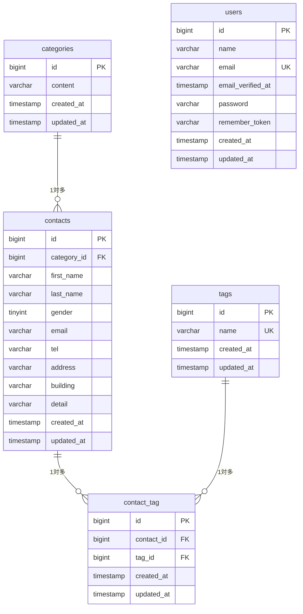

# COACHTECH お問い合わせフォーム

## 概要

一般ユーザーが利用できる公開のお問い合わせフォームと、管理者がログインして問い合わせを管理する画面を備えた Web アプリケーションです。

### 実装した機能

**基本機能**

- お問い合わせフォーム（入力 → 確認 → 送信 → サンクスページ）
- 入力値のバリデーション（FormRequest・日本語エラーメッセージ）
- 管理者の新規登録・ログイン・ログアウト（Laravel Fortify）
- 管理画面でのお問い合わせ一覧表示（7件ごとのページネーション）
- 名前・メールアドレス・性別・カテゴリ・日付による絞り込み検索
- お問い合わせ詳細表示・削除
- タグの追加・編集・削除

**応用機能**

- 検索条件に対応した CSV エクスポート（BOM 付き）
- 公開 API（お問い合わせの一覧取得・詳細取得・作成・更新・削除）

## ER図



- categories と contacts は 1対多（1つのカテゴリに複数のお問い合わせが属する）
- contacts と tags は 多対多（中間テーブル contact_tag で管理、contact_id と tag_id の組み合わせにユニーク制約）

## 使用技術

| 項目 | バージョン・名称 |
| --- | --- |
| PHP | 8.2 |
| Laravel | 10.x |
| データベース | MySQL 8.0 |
| Web サーバー | Nginx |
| フロントエンド | Vite / Tailwind CSS ^3.4 / Alpine.js |
| 認証 | Laravel Fortify |
| 開発環境 | Docker / Laravel Sail / phpMyAdmin |

## 環境構築手順

### 1. リポジトリをクローンする

```bash
git clone <このリポジトリのURL> contact-form-app
cd contact-form-app
```

### 2. 依存パッケージをインストールする

```bash
docker run --rm \
    -u "$(id -u):$(id -g)" \
    -v "$(pwd):/var/www/html" \
    -w /var/www/html \
    -e COMPOSER_CACHE_DIR=/tmp/composer_cache \
    laravelsail/php82-composer:latest \
    composer install
```

### 3. 環境設定ファイルを作成する

```bash
cp .env.example .env
```

`.env` のデータベース設定を以下にします。

```
DB_CONNECTION=mysql
DB_HOST=mysql
DB_PORT=3306
DB_DATABASE=laravel
DB_USERNAME=sail
DB_PASSWORD=password
```

### 4. コンテナを起動する

```bash
./vendor/bin/sail up -d
```

### 5. アプリケーションキーを生成する

```bash
./vendor/bin/sail artisan key:generate
```

### 6. マイグレーションと初期データ投入を実行する

```bash
./vendor/bin/sail artisan migrate --seed
```

### 7. フロントエンドをビルドする

```bash
./vendor/bin/sail npm install
./vendor/bin/sail npm run build
```

### 8. 動作確認

ブラウザで http://localhost にアクセスします。

## 開発環境URL

| 用途 | URL |
| --- | --- |
| アプリケーション | http://localhost |
| phpMyAdmin | http://localhost:8080 |

## 管理者アカウント（シーディングで作成）

| 項目 | 値 |
| --- | --- |
| メールアドレス | admin@example.com |
| パスワード | password123 |

## 画面一覧

| 画面 | メソッド | パス | 認証 |
| --- | --- | --- | --- |
| お問い合わせフォーム入力 | GET | / | 不要 |
| お問い合わせ確認 | POST | /contacts/confirm | 不要 |
| お問い合わせ送信 | POST | /contacts | 不要 |
| サンクスページ | GET | /thanks | 不要 |
| 管理者登録 | GET/POST | /register | 不要 |
| ログイン | GET/POST | /login | 不要 |
| ログアウト | POST | /logout | 必要 |
| 管理画面（一覧・検索） | GET | /admin | 必要 |
| お問い合わせ詳細 | GET | /admin/contacts/{contact} | 必要 |
| お問い合わせ削除 | DELETE | /admin/contacts/{contact} | 必要 |
| CSV エクスポート | GET | /contacts/export | 必要 |
| タグ追加 | POST | /admin/tags | 必要 |
| タグ編集 | GET | /admin/tags/{tag}/edit | 必要 |
| タグ更新 | PUT | /admin/tags/{tag} | 必要 |
| タグ削除 | DELETE | /admin/tags/{tag} | 必要 |

## APIエンドポイント一覧

認証は不要です。

| メソッド | パス | 概要 | 成功時のステータス |
| --- | --- | --- | --- |
| GET | /api/v1/contacts | お問い合わせ一覧を取得（keyword / gender / category_id / date で検索可能） | 200 |
| GET | /api/v1/contacts/{contact} | お問い合わせ詳細を取得 | 200 |
| POST | /api/v1/contacts | お問い合わせを作成 | 201 |
| PUT | /api/v1/contacts/{contact} | お問い合わせを更新 | 200 |
| DELETE | /api/v1/contacts/{contact} | お問い合わせを削除 | 204 |

バリデーションに失敗した場合は 422 で日本語のエラーメッセージを返します。

### レスポンス例（GET /api/v1/contacts）

```json
{
  "data": [
    {
      "id": 1,
      "first_name": "山田",
      "last_name": "太郎",
      "gender": 1,
      "gender_label": "男性",
      "email": "test@example.com",
      "tel": "09012345678",
      "address": "東京都渋谷区",
      "building": null,
      "detail": "お問い合わせ内容",
      "category": { "id": 1, "content": "商品のお届けについて" },
      "tags": [{ "id": 1, "name": "緊急" }],
      "created_at": "2026-10-10 18:00:00",
      "updated_at": "2026-10-10 18:00:00"
    }
  ],
  "meta": {
    "current_page": 1,
    "last_page": 1,
    "per_page": 10,
    "total": 1
  }
}
```

## 作成者

高岡 典明
